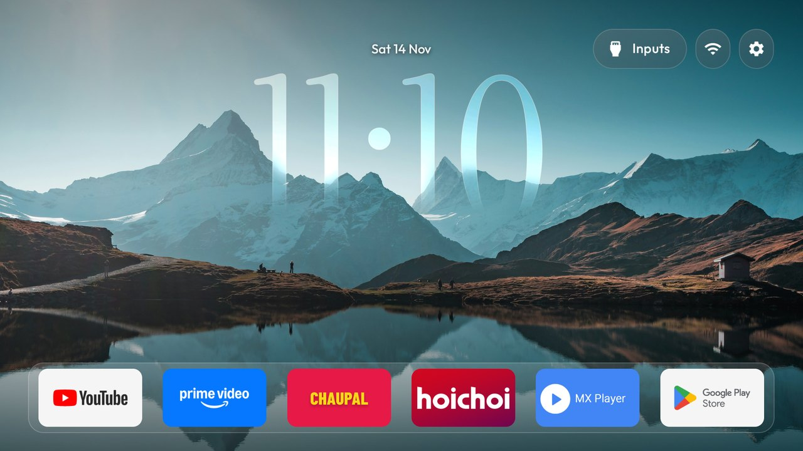

# Cursed



A photograph fills Home and the clock is part of it: large glass digits stand behind the nearer scenery, so peaks,
ridges and city towers cross their lower edge, and every time still reads.

- **Fifteen scenes** that follow the time of day: morning, daytime, evening, night (four night scenes: stars, northern
  lights, a lake under the Milky Way, an old town's lights), and fog when the weather reports it. Or a different one
  each start, or one you pin. While Home sits idle with its rows put away, the scene turns to another every few minutes.
- **Backgrounds you choose:** Home settings, Look and scenes, Backgrounds lists every scene with its picture;
  switch off the ones you do not want.
- **Keep watching:** a row of picture cards above the dock, with what your apps say you are part way through, the
  title on the card and the progress along its bottom. Hold OK on a card to take a show off the row.
- **One Home settings panel** beside Home, which changes as you choose: backgrounds, rows, the grid and dock,
  motion, weather. Its sections slide, its switches slide, and Home dissolves rather than blinks when you change one.
- **A tight glass dock**, icons without names, one focus look on every control.
- **30 languages** for everything this fork adds (machine translated, not reviewed by native speakers).

## Install

About ten minutes the first time, one command. You need:

| | |
|---|---|
| **A TV** | Android TV or Google TV, Android 8 or newer. Not Samsung, LG, Roku or Vizio (they are not Android TV). |
| **A computer on the same Wi-Fi** | macOS or Linux. On Windows use [WSL](https://learn.microsoft.com/windows/wsl/install): the installer is a shell script. |
| **Python 3** and **Docker or the Android SDK** | To build the launcher. With neither installed, [Docker Desktop](https://www.docker.com/products/docker-desktop/) is the easy one: the installer builds inside it. |
| **Debugging switched on, on the TV** | Next section. |

### 1. Switch debugging on

On the TV: **Settings > Device Preferences > About**, press **Build** seven times (it says you are a developer), go
back, open **Developer options** and turn on **USB debugging**, and **Network debugging** or **Wireless debugging** if
there is such a switch. Keep the TV on.

A Chromecast with Google TV or a Google TV Streamer has Wireless debugging with a pairing code; the installer needs the
classic port, so follow [Connecting](../../docs/TROUBLESHOOTING.md#connecting) once.

### 2. Run it

```bash
git clone -b cursed https://github.com/nnishad/cleanyourtv
cd cleanyourtv
tools/install-cursed.sh
```

It looks for TVs on your Wi-Fi (a few seconds), lists the ones with debugging switched on, and asks which is yours. When the
TV asks **Allow USB debugging?**, choose Always allow. Then it shows the TV's model and Android version and asks
**Go ahead?** once more: say `y`, and it:

1. sets up the tools (a Python environment inside the folder, nothing system-wide);
2. connects to the TV;
3. builds the launcher (with your Android SDK, or in Docker if you have none; the first Docker build makes a 1.5 GB image and takes a few minutes, a few more on an M-series Mac);
4. installs it and makes it the home screen, **turning off the TV's own launcher** (it stays installed, and nothing else
   is removed). It checks that the new launcher starts before the old one is touched, and puts the old one back if it
   does not;
5. gives it permission to read what you are part way through, and pushes this theme.

Press Home on the remote. That is it.

### Debloat too, without an assistant

`tools/install-cursed.sh` changes the home screen only. To also switch off what the TV maker runs that you do not
need, run the same job with the debloat added, still one command:

```bash
tools/setup-cursed.sh                    # or: tools/setup-cursed.sh 192.168.1.50
```

It asks which TV, shows its model, and then asks what to switch off. It looks in `examples/` for the **tested list that
names this TV's build** (by its model and firmware fingerprint) and offers it; a list is for one firmware, so it never
guesses from a similar name. With no match, it offers only the voice, advertising and telemetry services this TV reports
about itself (the audit of `tools/privacy.py`). Either way you **read the list** (`v` shows all of it, `e` edits it) and
say yes. The launcher goes on first and the list is applied last, because some lists need the new launcher in place.
Your own list works too: `--list my-list.txt` (one package name a line, `#` for comments).

What it will not do: uninstall anything (everything is switched off, and can be switched back on), touch the packages
Android needs to boot (`tools/disable.sh` refuses them), or change anything before you say yes. A TV with no tested list
gets only the generic audit, which is far less than a tested list switches off; for a deeper clean there, use the
[assistant prompt](AGENT-PROMPT.md) or the main README's "Doing it by hand".

### 3. Close the door

Switch USB and Network/Wireless debugging **off** again in Developer options: while it is on, anyone on your Wi-Fi can
control the TV. Check from the computer:

```bash
tools/venv/bin/python -I tools/adb-closed.py <your TV's address>
```

## Options

**Address, search and questions.** If you know the TV's address (Settings > Network), skip the search:
`tools/install-cursed.sh 192.168.1.50`. `tools/install-cursed.sh --find` only lists the TVs it can see. The search
covers this computer's own network (the /24 around its address); for a bigger or different one, add
`--subnet 192.168.1.0/24`. `--yes` skips the final question, for a script or an assistant that has already asked you.
Run without a keyboard (no terminal to answer on) and without `--yes`, it refuses to change anything.

**Weather** beside the date ("☁ 4° Overcast"). With nothing set up it uses **where the TV says it is**: Android works a
position out from the Wi-Fi networks around the TV when the TV's **Location** setting is on (Settings > Device
Preferences > Location). The installer has already given the launcher the permission; if it is missing, **Home settings >
Weather > Allow access to location** asks for it. The position is worked out on the TV and kept for a week. Many TVs
have Location switched off, or never give a position; then Home settings > Weather says so, and the weather waits.

To choose the place yourself, which then wins: **Home settings > Weather > Place**, press OK, type your nearest city with
the TV's keyboard, press Search, and pick the right one from the list (places with the same name are told apart by
region and country). What you type goes to Open-Meteo (free, no account) once, to find the place. Either way the
place's coordinates (rounded to a kilometre) go to Open-Meteo for the forecast every 30 minutes while Home is on screen,
and nothing else is sent. "Forget the place" takes your choice away and goes back to the TV's location; the switch above
turns the weather off altogether, and while it is off the launcher makes no network request.

**Keep watching** is hidden until an app reports something you were part way through; Netflix, YouTube and others do.
The installer has already given the launcher permission to read that list (and only read it).

**Building on a computer that has the Android SDK but you would rather use Docker**, or the other way round:
`BUILD=docker tools/install-cursed.sh` or `BUILD=native ...`. `--no-build` installs the APK you built last time.

## Using it

- **The gear** opens Home settings (backgrounds, rows, the grid and dock, motion, weather) and TV settings.
- **Inputs** is the button at the top right, with the TV's HDMI inputs, Bluetooth and Network.
- **Hold OK on an app** to move it, add it to the dock or see its info; **on a Keep watching card** to take the show off.
- **Up from the dock** goes to Keep watching. After a minute of nothing the rows fade away and the picture takes over;
  any button brings them back.

## With an AI assistant instead

[AGENT-PROMPT.md](AGENT-PROMPT.md) is a prompt to paste into one (Claude Code, Codex, ...) that does the same job and
sets its own rollback points: a git checkpoint of the files, and the records above for the TV.

## Update

```bash
git pull
tools/install-cursed.sh
```

Your apps and their order are kept. If the update changed the theme file, the choices you made in Home settings start again from the theme.

## Undo, and what keeps it safe

```bash
tools/install-cursed.sh 192.168.1.50 --rollback      # your TV's address; asks once, --yes skips that
```

That takes the theme off, switches back on whatever a `--debloat` list switched off, turns the TV's own launcher back on and
makes it Home again, and removes the Cursed launcher if it was not on the TV before. It checks that Home really went back before it removes anything, and if the TV's own
launcher does not take Home, it leaves the Cursed launcher in place and says so, so the TV is never left without a home screen.
To take off only the theme: `tools/theme.sh --reset`.

Three things are written down **before** the installer changes anything:

| What | Where | Holds |
|---|---|---|
| The TV's original state | `~/.cleanyourtv/cursed-<address>.txt` on your computer | Which launcher owned Home, which stock launchers were on, whether the Cursed launcher was installed. A second run keeps the first record, so running the installer again never overwrites how the TV was. If the TV does not answer when it is read, nothing is changed. Not in git: it holds device details. |
| A checkpoint of the files | a git tag `cursed-before-install-<date>` in your clone | `git reset --hard <tag>` puts the repository back as it was, which is what to use if an assistant (or you) edited files in it. It does not include uncommitted changes, so commit them first. |
| What a debloat switched off | `~/.cleanyourtv/recovery-<address>-<id>.json`, and a copy of the list in the same folder | Written by `tools/disable.sh` before its first change. `--rollback` replays it, or on its own: `tools/restore.sh <the list copy>`. |
| An automatic handover check | inside `launcher/build-and-install.sh` | The new launcher is started before the old one is turned off, and if Home does not end up on it, the old one is put back at once; if that cannot finish, the commands that do are saved in a file in your home folder. |

[docs/restore.md](../../docs/restore.md) has the rest.

## If something goes wrong

| What you see | What to do |
|---|---|
| *No TV with network debugging switched on was found* | Switch USB debugging (and Network or Wireless debugging) on in the TV's Developer options, keep the TV on, and run it again. A TV that answers with debugging off is named in the output. On another network, add `--subnet`; or give the address. |
| *Nothing could be reached at all* | On a Mac, allow your terminal under **System Settings > Privacy & Security > Local Network** and reopen it. |
| *could not talk to the TV* | Is it on, is debugging on, did you press Allow on the TV, is the address right? On a Mac, allow your terminal under **System Settings > Privacy & Security > Local Network**, then reopen it. More in [Connecting](../../docs/TROUBLESHOOTING.md#connecting). |
| No *Developer options* after pressing Build seven times, or USB debugging is greyed out | Some operator boxes lock it; nothing can reach the TV then. See [Troubleshooting](../../docs/TROUBLESHOOTING.md#connecting). |
| *nothing to build with* | Install and start Docker Desktop, then run it again. |
| *Unsupported class file major version* | Your JDK is too new for Gradle. Use Docker: `BUILD=docker tools/install-cursed.sh`. |
| *INSTALL_FAILED_OLDER_SDK* | The TV is older than Android 8. The launcher cannot run on it; nothing was changed. |
| The screen is black or blank after a restart | Press Home. If it stays, run `tools/install-cursed.sh <address> --rollback`. |
| Keep watching stays empty | Nothing has reported progress yet, or the permission was refused: Home settings > Home rows > Allow access to Watch Next. |

## How this differs from upstream CleanYourTV

The scenes, the clock and the settings panel are launcher code, so the theme needs this branch's launcher. The launcher
upstream ignores these keys.

| | Upstream launcher | This branch |
|---|---|---|
| APK size | about 0.6 MB | about 28 MB (the photos are stored losslessly) |
| Permissions | none for network | `INTERNET`, used only by the weather line (Open-Meteo); location, to put the weather where the TV is (the TV works it out, nothing leaves it but the rounded coordinates, and only for the forecast); `READ_TV_LISTINGS` for Keep watching |
| Based on | current `main` | upstream as of launcher 3.3 |

This installs the launcher and the look only. To also switch off the TV maker's ads and preloaded apps, follow the
main [README](../../README.md); the two work together.

## Tested on

An Android TV 12 emulator at 1920x1080, where the screenshot and the installer were tested. An earlier build of this
branch ran on an Android TV 11 set with 2 GB of RAM. This build has not been run on a real TV yet, and not measured on
any: the cross-fades are full-screen blends, which a slow graphics chip may not do smoothly. On a 1 GB set the photos
may be too heavy. The installer, its search for TVs and its questions were run against that emulator on a Mac (the search found a device on this computer's loopback, not a real TV: the real one was off), and so were choosing a city for the weather and the TV-location path (fed a test location in Vilnius: the weather came out as Vilnius's, not the machine's own). Whether a real TV gives a location has not been tried. They were not tried on Linux, Windows (WSL), a Docker build or a real TV.

## Credits

Photos and fonts: [launcher/SCENES-CREDITS.md](../../launcher/SCENES-CREDITS.md). Two of the night photos are
CC BY-SA 4.0 (share-alike): keep their credit if you redistribute. Built on
[CleanYourTV](https://github.com/Gathin23/cleanyourtv); the scenes look comes from [couch-tv](https://github.com/Seagey/couch-tv).
